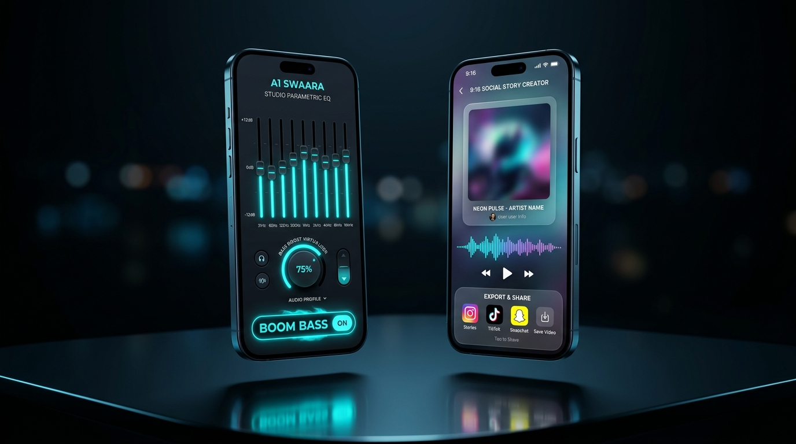
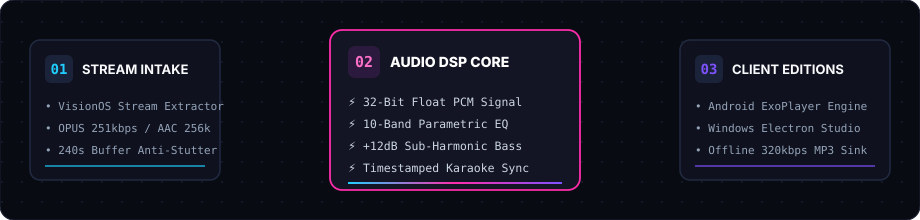

<p align="center">
  <a href="https://github.com/VarshuDev/A1Swaara_apk">
    
  </a>
</p>

<p align="center">
  <strong>High-Performance Sovereign Audio Streaming &amp; Studio Suite for Android and Windows PC.</strong>
</p>

<p align="center">
  <a href="LICENSE"></a>
  <a href="https://github.com/VarshuDev/A1Swaara_apk/releases"></a>
  <a href="#-downloads--releases"></a>
  <a href="#-audio-dsp-pipeline"></a>
  <a href="https://github.com/VarshuDev"></a>
</p>

<p align="center">
  <a href="#-downloads--releases">📦 Downloads</a> •
  <a href="#-visual-showcase">📱 Visual Showcase</a> •
  <a href="#-audio-dsp-pipeline">🧬 Signal Pipeline</a> •
  <a href="#-core-feature-matrix">📊 Comparison</a> •
  <a href="#-a1-swaara-pc-edition">💻 PC Edition</a> •
  <a href="#-quickstart">⚡ Quickstart</a>
</p>

---

## ⚡ What is A1 Swaara?

**A1 Swaara** is a modern, sovereign audio streaming studio designed for pure fidelity, zero interruptive advertisements, instantaneous 320 kbps stream extraction, real-time synchronized karaoke lyrics, and studio-grade parametric equalization.

Built with an **obsidian glass aesthetic** (`#07080D`), A1 Swaara bridges the gap between mobile streaming and desktop studio listening across **Android** and **Windows PC**.

```
+──────────────────────────────────────────────────────────────────────────+
│  AUDIO PIPELINE: A1 SWAARA SOVEREIGN SUITE (ANDROID + WINDOWS PC)        │
│  AUTHOR: VarshuDev (https://github.com/VarshuDev)                        │
│  FIDELITY: 320 KBPS CD-QUALITY * 32-BIT PCM * ZERO TELEMETRY TRACKING   │
+──────────────────────────────────────────────────────────────────────────+
```

---

## 📦 Downloads & Releases

<table width="100%">
  <tr>
    <td width="50%">
      <h3>📱 Android APK (v1.0.2)</h3>
      <p>Direct standalone APK package optimized for modern ARM64 &amp; x86 Android devices:</p>
      <ul>
        <li><strong>Direct APK Download</strong>: <a href="A1_Swaara_v1.0.2.apk"><code>A1_Swaara_v1.0.2.apk</code></a> (~12.8 MB)</li>
        <li><strong>OTA Configuration</strong>: <a href="version.json"><code>version.json</code></a></li>
        <li><strong>Release Channel</strong>: <a href="https://github.com/VarshuDev/A1Swaara_apk/releases">GitHub Releases</a></li>
      </ul>
    </td>
    <td width="50%">
      <h3>💻 Windows PC Edition</h3>
      <p>Native hardware-accelerated desktop edition powered by Electron &amp; Web Audio API:</p>
      <ul>
        <li><strong>1-Click Desktop Launcher</strong>: Double-click <code>launch-swaara-pc.bat</code></li>
        <li><strong>Source Engine</strong>: Located in <code>swaara-pc/</code> (Electron + React 19 + TypeScript)</li>
        <li><strong>Offline MP3 Sink</strong>: Auto-saves directly to <code>Music/A1 Swaara</code></li>
      </ul>
    </td>
  </tr>
</table>

---

## 📱 Visual Showcase

<table align="center" width="100%">
  <tr>
    <td width="50%" align="center">
      <strong>🎵 Now Playing &amp; Synced Karaoke Lyrics</strong><br>
      <em>Dynamic ambient backlight glow with real-time timestamped word tracking.</em><br><br>
      
    </td>
    <td width="50%" align="center">
      <strong>🎛️ 10-Band Studio Equalizer &amp; Bass Pump</strong><br>
      <em>Hardware DSP shaping, +12dB sub-harmonic bass, and 9:16 Story Creator.</em><br><br>
      
    </td>
  </tr>
</table>

---

## 🧬 Audio DSP Pipeline

A1 Swaara's audio architecture bypasses standard mobile dynamic volume compressions, passing clean streams through high-precision audio sinks:

<p align="center">
  
</p>

1. **Unthrottled Stream Extraction**: Uses the InnerTube / VisionOS extraction engine to negotiate peak bitrates (OPUS 251 kbps and AAC 256 kbps) with a 240-second anti-stutter lookahead buffer.
2. **32-Bit Floating-Point PCM Processing**: ExoPlayer on Android and Web Audio API on PC process audio at full 32-bit float resolution, enabling bit-perfect delivery to external DACs and USB amplifiers.
3. **Parametric Equalization**: 10-band studio EQ spanning from 32 Hz sub-bass to 16 kHz air frequencies with an independent resonant sub-harmonic bass boost.
4. **Zero Dynamic Range Compression**: Bypasses volume compression algorithms and silence-skipping filters for raw dynamic range.

---

## 📊 Core Feature Matrix

| Feature | A1 Swaara Suite | Spotify (Free) | YouTube Music | Generic Media Players |
| :--- | :---: | :---: | :---: | :---: |
| **Audio Advertisements** | 🚫 **Zero (Never)** | Interruptive Ads | Video Interruptions | None |
| **Peak Stream Quality** | 🎧 **320 kbps (Lossless)** | 160 kbps | 256 kbps (Paid) | Varies |
| **Offline Downloading** | ✅ **Free (Selective MP3)** | Paid Premium Only | Paid Premium Only | Local files only |
| **Background Audio** | ✅ **Free (Unlimited)** | Restricted | Paid Premium Only | Free |
| **Synced Karaoke Lyrics** | ✅ **Built-in Auto-Scroll** | Limited Free | Paid Tier Only | Plugin dependent |
| **Studio Equalizer** | 🎛️ **10-Band + Sub Bass** | 5-Band Basic | 5-Band Basic | 5-Band |
| **Social Story Creator** | 📸 **Built-in 9:16 Canvas** | External Redirect | Static Only | None |
| **Telemetry & Tracking** | 🔒 **Zero Telemetry** | Extensive Profiles | Extensive Ad Tracking | Varies |

---

## 💻 A1 Swaara PC Edition

The dedicated desktop version of A1 Swaara is engineered with **Electron, React 19, TypeScript, and Vite**, equipped with hardware-accelerated Web Audio API processing:

- **Obsidian Glass Frameless UI**: Frameless window design with custom drag titlebar and album-art color reflection.
- **Real-Time 40-Bar Spectrum Visualizer**: Hardware-accelerated dynamic spectrum analyzer reacting to live audio frequencies.
- **Language Discovery Matrix**: Instant discovery shelves for Kannada, Hindi, English, Punjabi, Tamil, Telugu, Malayalam, and Lo-Fi Chill.
- **1-Click 320 kbps MP3 Downloader**: Directly downloads high-bitrate tracks to your local `Music/A1 Swaara` folder.
- **Social Story Studio**: Export 9:16 vertical Instagram/WhatsApp story cards with song waveforms and customizable 60-character vibe notes.
- **Picture-in-Picture Mini Player & Zen Fullscreen**: Compact `380×210` desktop floating widget and distraction-free fullscreen mode (`F`).

### ⌨️ Desktop Keyboard Shortcuts

| Shortcut | Action |
| :--- | :--- |
| <kbd>Space</kbd> | Play / Pause Toggle |
| <kbd>←</kbd> / <kbd>→</kbd> | Seek Backward / Forward 5 seconds |
| <kbd>↑</kbd> / <kbd>↓</kbd> | Volume Up / Down 5% |
| <kbd>Shift</kbd> + <kbd>N</kbd> | Skip to Next Track |
| <kbd>Shift</kbd> + <kbd>P</kbd> | Skip to Previous Track |
| <kbd>M</kbd> | Mute / Unmute Audio |
| <kbd>F</kbd> | Toggle Immersive Zen Fullscreen Mode |
| <kbd>Esc</kbd> | Exit Modals / Dismiss Fullscreen |

---

## ⚡ Quickstart

### Launching Android Edition:
1. Download [`A1_Swaara_v1.0.2.apk`](A1_Swaara_v1.0.2.apk) onto your Android device.
2. Tap the file to install (enable *Install Unknown Apps* if prompted).
3. Open **A1 Swaara** and start streaming immediately—no account required.

### Launching PC Edition:

#### Option A: 1-Click Launcher (Windows)
Double-click:
```cmd
launch-swaara-pc.bat
```

#### Option B: Terminal Setup
```bash
# Navigate to the PC directory
cd swaara-pc

# Install dependencies
npm install

# Run in web browser (localhost:5173)
npm run dev

# Run as native Windows desktop app
npm run electron
```

---

## 👨‍💻 Author & Credits

Engineered and maintained by **[VarshuDev](https://github.com/VarshuDev)**.

Released under the **[GNU General Public License v3.0](LICENSE)**.
